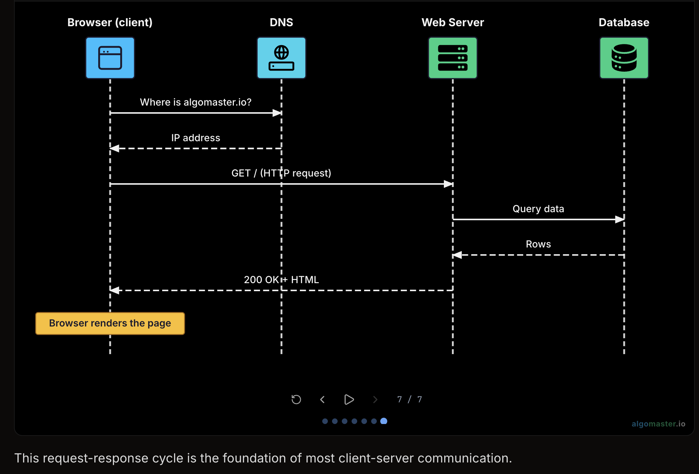

# Client-Server

Most of it is known, not mentioning much here.

Request Response Cycle:

# Microservices

Mostly known info since this is what we do at work. Nonetheless, [blog](https://medium.com/hashmapinc/the-what-why-and-how-of-a-microservices-architecture-4179579423a9) for quick glance

# Serverless

[blog](https://blog.algomaster.io/p/2edeb23b-cfa5-4b24-845e-3f6f7a39d162) for quick glance

- Cloud runs your code as small functions. You do not manage VMs or patching.
- Runs when an event fires (HTTP, file upload, schedule, etc.). Pay per run time and memory, not idle servers.

Advgs:  
    - No capacity planning for machines  
    - Scales up and down with traffic  
    - Good for bursty or low-traffic workloads

Disadvgs:  
    - Cold start delay after idle  
    - State lives in DB/S3/etc., not in the function  
    - Time and memory limits per run  
    - Tied to one cloud's APIs / vendor lock-in

# Event-Driven Architecture

[overview](https://www.confluent.io/learn/event-driven-architecture/)

- Services announce that something happened. Others react on their own instead of blocking on a direct call.
- Publisher sends to a broker (e.g. Kafka). Subscribers read and process in the background.
- Related ideas: pub/sub, event sourcing, CQRS, eventual consistency.

Advgs:  
    - Publisher does not need a list of every downstream service  
    - Add a new consumer without changing the producer  
    - Scale and deploy pieces separately  
    - Replay from a log after failures

Disadvgs:  
    - Harder to trace one request end to end  
    - Ordering and duplicate messages need care (idempotent handlers)  
    - More infra to run and monitor

# Peer-to-Peer (P2P)

[overview](https://www.spiceworks.com/networking/what-is-peer-to-peer/)

- Peers talk to each other directly. Each node can send and receive (no central server for the main work).
- Peers share files, bandwidth, or compute. Nodes join and leave; discovery uses DHT, directories, or similar.
- Examples: BitTorrent, Bitcoin, some chat/CDN setups.

Advgs:  
    - Spreads load across participants  
    - No single central choke point for distribution  
    - Still works if some nodes go offline

Disadvgs:  
    - Lack of centralisation: Hard to enforce one policy everywhere  
    - Speed depends on who is online  
    - Trust and abuse are harder than in a controlled server

