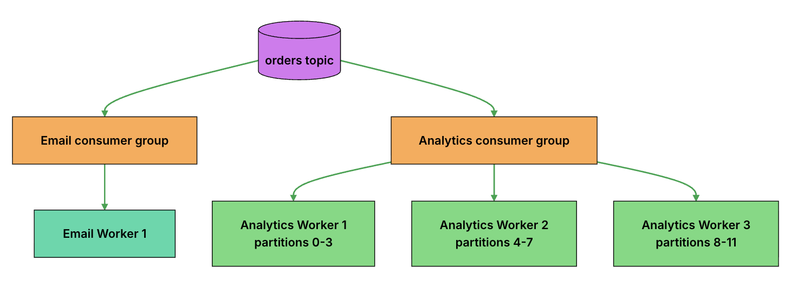
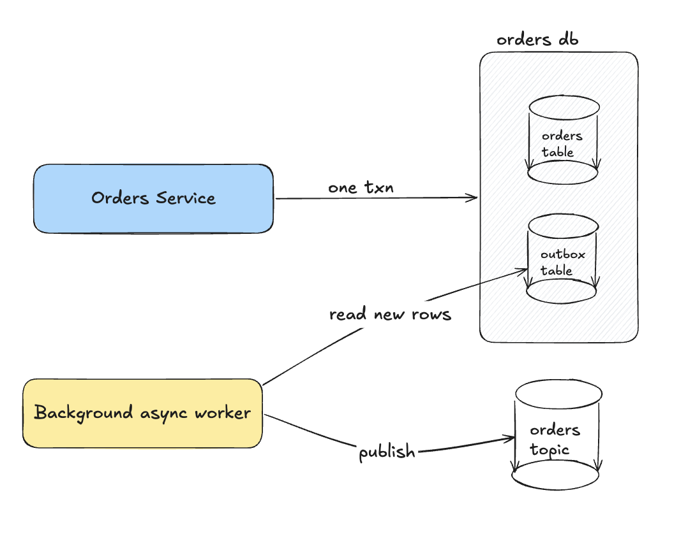
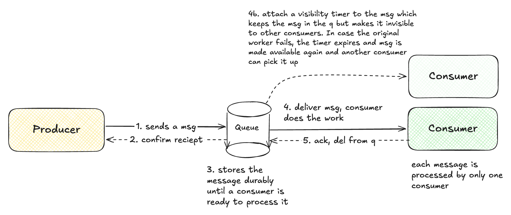

# Pub/Sub

Messaging pattern with 3 main parts: 

1. Publisher: Services that produce the messages
2. Subscriber: Services that want to receive those messages. They register their interest in a topic.
3. Broker: Sits in between and delivers a copy of the every message on a topic (a named channel for a particular kind of event) to each subscriber.

## Life of a message

1. Publish and Store
- Publisher sends message to a topic on the broker
- Broker stores it and sends an ack back to publisher

2. Deliver to every subscription
- Broker makes the message available to every subscription on that topic

3. Process and ack
- Each subscriber receives the message, processes it and sends an ack.
- If the subscriber crashes before ack, broker retries again. Thus, subscribers must be idempotent.

## Types

### Pull v/s Push

- Push 
    - Broker sends message to every subscriber, usually via an HTTP POST endpoint that the subscriber exposes.
    - Simple and no polling needed
    - Broker controls pace so subscriber needs to manage bursts. Subscriber endpoint must stay reachable.
    - Better for serverless fns and simple integrations.
- Pull
    - Subscriber polls the broker for new messages.
    - Subscriber controls its own pace.
    - But need to run polling workers.
    - Better for high throughput backend processing

### Ephemeral v/s Durable

- Ephemeral
    - When the publisher sends the message, Redis forwards it to whoever is subscribed at that moment and then message is gone. No replay.
    - Eg: Redis Pub/Sub
- Durable
    - Messages wait until subscriber acks or until a retention period.
    - Eg: Google Cloud Pub/Sub
- Replayable log
    - Keep messages until a fixed time in an append only log, regardless of whether anyone has read it.
    - Each subscriber tracks its position in the log through an offset. They can then rewind its offset and replay all events (again need idempotency)
    - Eg: Kafka

## Message Ordering

- In general, pub/sub systems don't guarantee that messages will arrive in order. Reasons:
    - Messages spread across many partitions
    - Retries can change order

### Ordering by key

- Preserve order for messages with the same key. 
- Key can be like an order id. So all messages associated with an order id arrive in order. 
- Messages with different order ids continue processing in parallel.

### Cost of ordering
- Reduced parallelism.
- If the same key receives far more traffic, then that can become a bottleneck.

### Handling out of order events

- Use version numbers
- Eg: if a subscriber has already applied version 5 of an order, it can safely drop a late version 4.

## Scaling Subscribers

- Suppose a given topic receives 50K events per second and a single analytics consumer cannot keep up.
- Create a *consumer group/ share subscription / competing consumers* which is a set of workers that share on subscription's work. 
- The grp still gets every event but inside a group, each event is handled by only one worker.

- Number of partitions (workers inside the grp) determine parallelism. 
- No of partitions = no of events being processed in parallel.

- Consumer lag measure how far behind the consumer is from the latest message in a partition.
- If its too behind, that means workers are not processing events fast enough and we need more workers / partitions.

## Publishing Reliably: The Outbox pattern

- Dual Write Problem
    - What if the order is placed and saved but the service crashes before sending the `OrderPlaced` event.
    - Now the order has been placed but downstream services will never know about it. 
    - Problem is happening because we need to update two separate systems.

- Solution: The Transactional Outbox
    - Save the order and the event in the same DB, in a single transaction. Either both happen or none.
    - Event goes into a separate `outbox` table.
    - A background process then reads the outbox table for any new rows and publishes them to the msg broker. If that process itself crashes, then it can resume and publish any remaining events.

## When to use?

- Notifications
- Orders and payments
- Activity tracking

### Trade-offs

- Eventual consistency: because subscribers process events async, diff parts of the system may not be updated at the same time.
- No immediate response
- Harder debugging

# Message Queues

- It is a buffer that sits between two services:
    - Producers: are services that create work
    - Consumers: are services that do the work

## Scaling

- Add more consumers. Called as competing consumers pattern
- Queue Depth: # of msgs waiting to be processed. if too high, add more consumers.
- **prefetch** multiple msgs in a single call to reduce n/w round trip. although if one consumer grabs many msgs while others are idle, that can also lead to a bottleneck.
- Queues also help protect the system from sudden spikes in traffic

## Poison Messages and Dead Letter Queues

- A problematic message (due to the file being corrupted for example) might be retried and put back into the queue forever. Such messages are called poison messages.
- Solution? Put a retry limit.
- Beyond the retry limit, move the message into a separate dead-letter queue (DLQ). This keeps the problematic message from interfering with normal processing. Messages inside this can be inspected and retried later.

## Message ordering

- Even through the word queue suggests, FIFO, it does not guarantee the same.
- One worker might have picked message 1 which took a much longer time than message 2 being picked and processed. 
- Retries can also change the processing order.
- But sometimes strict ordering is needed. In such scenarios, group related messages with IDs.
- So msgs from the same group (like a particular order) are processed in order while other messages can be processed in parallel.

## Designing messages

- Keep them small. Eg: include link to file object in S3 instead of the file.
- Include a unique ID to detect duplicates.
- Versioning
- Message type

## When to use

When tasks are slow, resource-intensive, or don't need to finish before the user receives a response.

- Processing Webhook events
- Sending emails and notifs
- Processing images and videos
- Generating reports

# Change Data Capture

- Data from the source DB might need to show up in other places too. CDC is a technique to efficiently publish those changes and update other systems
- Capturing changes to the DB and sending it to other systems as they happen.
- Turns database changes (like row inserted, updated, etc) into change events

## How it works

1. Capture: Detect **committed* changes from the source DB
2. Build events: Create change events
3. Publish: Publish the event onto a queue, topic, or any other system for consumption
4. Consume: Other systems read the events and update their own data

## CDC Approaches

1. Timestamp based

- Use an `updated_at` column to find changed rows
- Pros: 
    - Simple
- Cons:
    - Still polling
    - If a row changes three times between polls, you may only see the final value.
    - Use soft deletes. Hard deletes will remove the row and you will never capture the change

2. Trigger based

- Use DB triggers to add changes into an outbox table (txn outbox pattern)

- Pros: 
    - Can capture deletes
    - Useful for audit tables and txn outbox pattern
    - Useful when txn logs are hard to access

- Cons:
    - Tightly coupled with the application write code. On a busy table, this extra work can slow down the overall write speed
    - Harder to maintain. Table changes may also mean trigger changes.
    - Wrong trigger code can stall the application writes.

3. Log based

- Use the DB transaction log which the DB already uses for restoration.
- Preferred for many high volume systems
- Eg: Debezium (OSS)

- Pros: 
    - FB already writes these as part of normal operation
    - Less impact on application than triggers.
    - Better scaling
- Cons:
    - Setup and ongoing care
    - Need DB specific settings, safe permissions 

## CDC v/s Events

- CDC capture every change
- Events capture the final state. An `OrderPlaced` event while CDC might have captured the orders, payments, audit etc tables updated.
- Outbox pattern still applicable. You can connect a CDC connector to the outbox table to replicate changes.

## Use cases

- Replication
- Audit
- Cache Invalidation
- Data warehousing / analytics
- Search indexing: update ElasticSearch as and when DB value updated

## Challenges

- Lag
- Ordering: ordering can change when source uses partitions, or events processed by many workers.
- Handling deletes: Discussed in timestamp based CDC. Use appropriate method like tombstone event, soft delete, etc to handle delete events.
- Schema Evolution: changes in schema should not break CDC events. Prefer additive changes, versions, 
- Initial snapshot: systems need a starting point after which the new events can be streamed. This snapshot could be big requiring time.
- Security and Privacy: CDC events might expose columns that weren't meant to be. Mask, include only what's needed, encrypt data, apply retention rules.
- Log retention: what if CDC connectors dies for a big enough time that logs are not retained. Might need to start again from a snapshot.