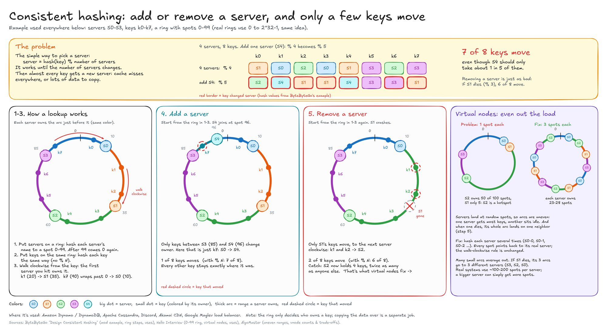
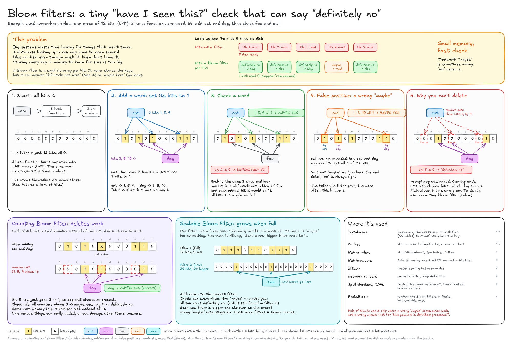

# ACID Transactions

## Atomicity

- Either all changes happen or nothing happens.
- Changes inside a txn are not treated as final until the txn is committed.

## Consistency

- After a txn commits, the data should still follow the rules we defined for the DB like primary key, valid data type, `NOT NULL` constraints, `CHECK` constraints etc.

## Isolation
Controls what transactions can see when they run at the same time.

### Common concurrency problems:

> Don't Nap on Pizza, Loser — We skewed

| Letter | Problem | Explanation | Example |
|--------|---------|-------------|---------|
| D | Dirty read | A txn reads data another txn has not committed | You read someone's diary before they hit save. It's not real yet — you're sniffing uncommitted drama. |
| N | Non-repeatable read | A txn reads the same row twice and sees different committed values | You check your bank balance → $100. Blink. Check again → $40. Same row, new committed truth. |
| P | Phantom read | A repeated query returns a different set of matching rows | You count pepperoni slices twice. The count changed — not one slice moved, the whole set did. Ghost toppings. |
| L | Lost update | Two txns overwrite each other's changes | Two people edit the same Google Doc. Both hit save. One person's work gets yeeted — last writer wins. |
| W | Write skew | Two txns read overlapping data but modify different non-overlapping parts, collectively violating a DB rule | Two surgeons each operate on a different organ. Neither sees the other's chart. Together they violate "patient must have ≥1 kidney." Fine alone, illegal together. |

### Isolation Levels

Higher isolation levels protect from more concurrency bugs but more time / conflicts.

| Isolation level   | Protects against                                      | Tradeoff                                           |
|-------------------|-------------------------------------------------------|----------------------------------------------------|
| Read uncommitted  | Very little                                           | Fast, but can read uncommitted changes           |
| Read committed    | Dirty reads                                           | Still allows some surprises across repeated reads |
| Repeatable read   | Many repeated read problems                           | Exact behaviour depends on DB                      |
| Serializable      | Makes txns behave as if they ran one at a time        | More blocking, failed txns, or retries             |

> same name setting can differ with db

DB use common techniques to enforce isolation: 
- Locks: make one txn wait for another
- MVCC (Multi Version Concurrency Control): lets readers see a stable snapshot while writes create newer _versions_ of same data. readers never block writers, and writers never block readers. Once fully committed, new version becomes the new stable snapshot.
- Range locks: locks over a group of rows
- Conflict detection: stop txn when not safe

## Durability

- Once committed, the DB can recover the older state after a crash.
- Write-Ahead Logging (WAL): Write the recovery record before relying on the changed data page. If the database crashes after commit but before the changed pages reach the main files, recovery can replay the WAL and restore the committed changes.

# SQL vs NoSQL

| Question         | SQL / Relational                                | NoSQL                                        |
|------------------|-------------------------------------------------|----------------------------------------------|
| Primary Model    | Tables, rows, columns, relationships            | Key-value, document, graph, time-series, wide-column |
| Query style      | SQL; describe the result you want               | Database-specific API or query language      |
| Schema           | Enforced by DB                                  | Flexible or query shaped                     |
| Relationships    | Joins, foreign keys                             | Embedded, duplicated, traversed, or handled by application code |
| Transactions     | Strong general purpose txn support              | Varies widely by DB                         |
| Scaling model    | Vertical, replicas, partitions, sharding        | Horizontal                                  |

## How to choose

Choose relational DB if:

- Data relationships matter
- Txns
- Good starting point
- Query patterns will evolve
- Data quality matters

Choose no sql if:

- Data model matches the db (like graph)
- Read and write pattern is clear
- Flexible records are useful
- Limited txn is acceptable 
- Horizontal scale is a first order requirement

# Data Replication

- The process of keeping copies of the same data across multiple locations

## How does it work

- Works by synchronizing changes from a primary data source to one or more replica destinations
- primary handles write operations, logs those changes and then those changes are propagated to replica nodes
- 3 stages: 
    1. Establishing an initial state - full snapshot or baseline copy of primary db
    2. Ongoing changes are captured by reading txn logs, monitoring timestamps on updated records or using DB triggers
    3. Apply changes to each replica

- Most common technique: CDC (Change Data Capture)
    - Reads db txn logs, applies changes with minimal impact on primary, order of txns preserved
- If the connection breaks between primary and replica, partial resync is applied 

## Benefits

1. DR and reliability
    - Metrics that define reliability: 
      1. Recovery Point Objective: how much data loss is acceptable
      2. Recovery Time Objective: how long the system can be offline
2. Increased performance: many read replicas can distribute traffic

## Types

> Based on timing: async, sync and semi-sync: Discussed in [High Availability Patterns](./core-concepts.md#high-availability-patterns)

1. Transactional: Begins with a full snapshot of the primary and then pushes realtime updates in exact order
2. Snapshot: Takes a _static_, point-in-time copy of a DB and sends the entire state to the replica nodes. Its like a periodic refresh.
3. Merge: Allows bidirectional updates where both publisher and subscriber can modify data, periodically merging changes and resolving conflicts. Its like hub and spoke model.
4. Master-Slave (Single Leader): One write accepting DB, rest are read-only where updates are pushed from master
5. Multi-Master (Multi Leader): Allows two or more masters to accept writes simultaneously, syncing changes across all masters.  
6. Peer to Peer replication: All servers are equal, handling both reads and writes.
7. Key-based / Incremental Replication: Tracks changes using a unique identifier and copies only those. Eg: CDC

## Challenges

1. Infra cost
2. Replication lag
3. Conflict Resolution: mainly when multiple nodes can accept writes and may update the same record. Use last-write-wins policies and CRDTs (Conflict-free Replicated Data Types) that merge concurrent changes
4. Bandwidth consumption: use log based CDC to reduce and send only incremental

# Database Architectures

1. 1-Tier: users works directly with the DB on the same system. Simple, cost effective but single-user, poor security
2. 2-Tier: client server. client application talks directly to the DB server
3. 3-Tier: Typical web architecture. Also similar to the ANSI-SPARC 3-Level schema
    - presentation layer (tier-1): user interface /client
    - business layer (tier-2): controller
    - DB layer (tier-3): physical data storage

# Database Indexes

Separate data structure that helps DB find rows without a full table scan.

Most DBs use a B-Tree or a B-Tree+.

## How a B-Tree index works

- B-Trees are an extension to binary trees. A node in a binary tree has utmost 2 children. Values left of the node are smaller and values to the right are larger.
- An m-way search tree is a tree where there can be utmost m children and thereby m-1 keys.
- A B-Tree is a m-way search tree with explicit rules for insertion. It can have a variable number of keys in a node. Eg: 4 keys => 5 children. Each key has a child pointer and a record pointer.
- Rules for insertion:
    - min m/2 children for each node except root node which can have min 2 children
    - all leaves must be at the same level
    - creation is bottom up
- B-Trees allow multi-level indexing.
- So similar to binary tree, we would check if the value to compare lies to the left, right or middle (or in between the keys if we have more keys) and continue towards the leaves. While insertion and deletion, the rules of insertion have to be respected and might then require splitting the node into more nodes. [Ref](https://youtu.be/K1a2Bk8NrYQ?si=ds-WaRARb2TvWyTu)
- In a B+Tree, record pointers are only from leaf nodes. Every non leaf key will then have its copy in one of the leaf nodes and leaves are connected like a linked list.

## Composite Index

- Index can be on two or more columns also
- Leftmost prefix rule: its read from left to right. 
- Suppose we have an index on three columns: (country, city, created_at). This index is primarily organized by country. Within each country, it is organized by city. And within each city, by created_at.

## Covering Index

- An index that covers every column that the query needs.
- Should be designed with care as large indexes take more space.

## Selectivity

- A column like `status` or boolean will not offer a lot of benefit with indexing since it only has few possibilities anyways. A scan will still match of the table with the index.
- Indexes are generally most valuable when they help the database narrow the result set significantly.

# Sharding

- Splitting a large dataset across multiple independent database instances. Each shard only stores a portion of the data.
- vs Replication: replication does copying while sharding stores diff subsets of the data
- vs Partitioning: partitioning involves splitting the tables within the same database. In sharding, data is distributed across multiple servers.
- A good shard key: 
    - spreads data and traffic evenly
    - makes common queries easier to route

## Types

### Range Based

- simple. Divide the space into ranges and assign each range to a shard.
- User ID: 1->100K shard 1, 100K+1->200K shard 2 and so on
- Advgs: 
    - simple
    - works well for range queries since they are closely related
- Disadvgs: 
    - traffic may not be evenly distributed and we'll get hot shards (one overloaded shard while others are idle). Like new user ids will always hit the same shard or a popular account

### Hash based

#### Modulo Hashing

- Apply a hash fn to the shard key and map the result to one of the shards.
- `shard = hash(user_id) % number_of_shards`
- Exact opposite advgs and disadvgs:
    - Spreads traffic evenly
    - But range queries now involve every shard since close values will be spread
    - Adding and removing nodes will result in almost entire redistribution of data because the denominator will change. For that consistent hashing

#### Consistent Hashing

- Solves the redistribution problem with modulo hashing by arranging data in a hash ring

### Directory based

- Here the system maintains a separate lookup table which has a map of data -> shard.

- Advgs:
    - flexibility. can move data around without the key changing
- Disadvgs:
    - separate piece of infra to maintain which must be fast and highly available
    - spf

## Querying

- Need a query router now which routes the request to the correct shard. Could be application, DB, a proxy etc.
- Sometimes you need to go to multiple shard and combine the results. Such queries are called cross-shard queries.
- Type of cross-shard query is a scatter-gather query where you broadcast it to every shard and then combine the results.
- For cross shard transactions, we need a distributed txn protocol like Saga. Avoid cross shard txns in the first place with a good shard key.
- Re-sharding might be required in the long run which may add nodes and also move data. Refer Consistent Hashing.

## When to shard

Before sharding a database, it is worth exhausting simpler options:

1. Optimize slow queries.
2. Add indexes.
3. Introduce caching.
4. Scale the database vertically.
5. Move read traffic to replicas.
6. Archive old data.
7. Partition large tables inside the database.

Sharding becomes useful when one database can no longer handle the dataset or the write workload efficiently, and the application needs to scale horizontally.

# Bloom Filters

