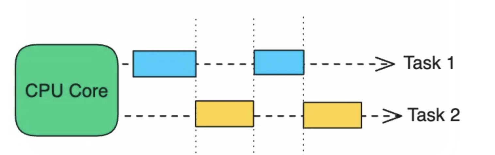
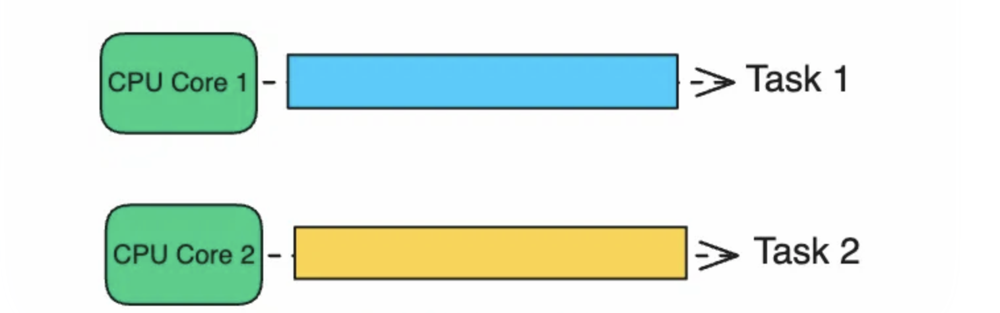
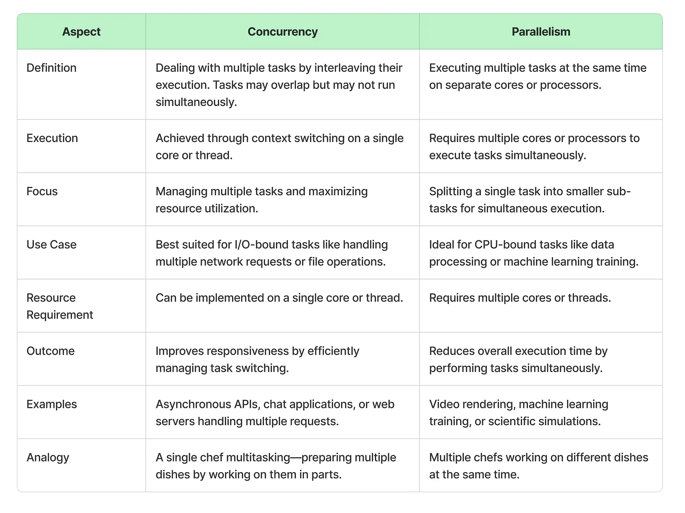
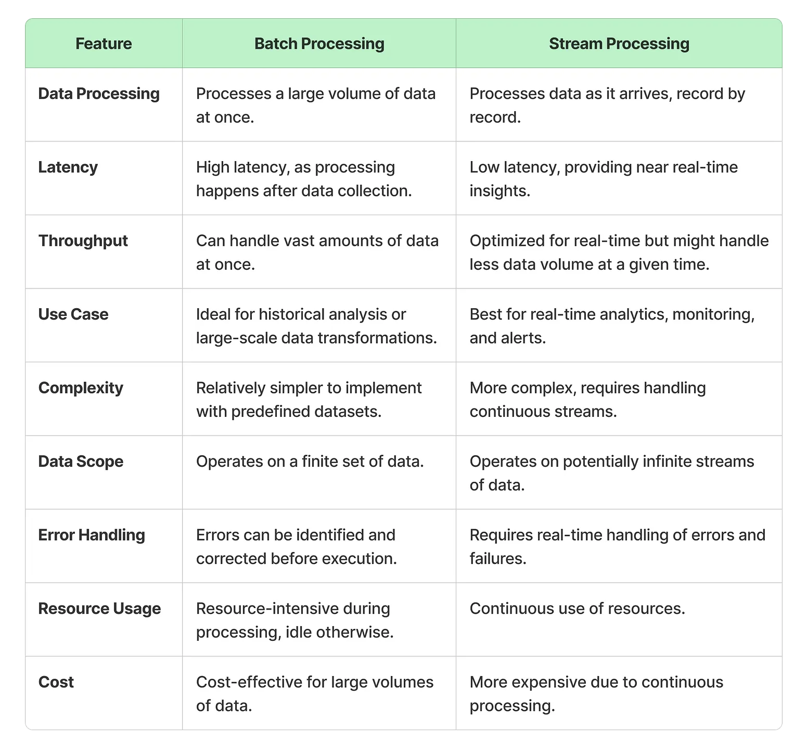

# Horizontal v/s Vertical Scaling

Covered in [Core Concepts](./core-concepts.md#scalability)

# Concurrency v/s Parallelism

## Concurrency 

## Parallelism

## Comparison 

# Websockets v/s long polling

Covered in [API fundamentals](./api-fundamentals.md#websockets)

# Batch Processing v/s Stream Processing

# Sta